# Функциональные возможности работы с БАРС-Офисом

## Содержание

- [1 Начало работы в БАРС-Офис](#1-начало-работы-в-барс-офис)
  - [1.1 Главное меню](#11-главное-меню)
    - [1.1.1 Панель быстрого доступа](#111-панель-быстрого-доступа)
    - [1.1.2 Местное время](#112-местное-время)
    - [1.1.3 Производственный календарь](#113-производственный-календарь)
  - [1.2 Профиль пользователя](#12-профиль-пользователя)
    - [1.2.1 Сменить тему](#121-сменить-тему)
    - [1.2.2 Привязка к telegram](#122-привязка-к-telegram)
    - [1.2.3 Настройки](#123-настройки)
    - [1.2.4 Выход](#124-выход)
- [2 Работа с документами БО](#2-работа-с-документами-бо)
  - [2.1 Инструменты поиска данных](#21-инструменты-поиска-данных)
    - [2.1.1 Редактор фильтров](#211-редактор-фильтров)
    - [2.1.2 Фильтрация по столбцам](#212-фильтрация-по-столбцам)
  - [2.2 Инструменты работы с записями](#22-инструменты-работы-с-записями)
    - [2.2.1 Группировка записей](#221-группировка-записей)
    - [2.2.2 Изменение записей](#222-изменение-записей)
    - [2.2.3 Итоговая информация](#223-итоговая-информация)
  - [2.3 Возможности отображения и инструменты настройки](#23-возможности-отображения-и-инструменты-настройки)
    - [2.3.1 Компоновка расположения зависимых документов](#231-компоновка-расположения-зависимых-документов)
    - [2.3.2 Открыть в окне](#232-открыть-в-окне)
    - [2.3.3 Пользовательские настройки отображения таблиц](#233-пользовательские-настройки-отображения-таблиц)
    - [2.3.4 Всплывающая информация (подсказки)](#234-всплывающая-информация-подсказки)
    - [2.3.5 Раскрывающаяся панель (Expand panel)](#235-раскрывающаяся-панель-expand-panel)
    - [2.3.6 Сохранение нескольких представлений отчетов](#236-сохранение-нескольких-представлений-отчетов)
  - [2.4 Дополнительные возможности](#24-дополнительные-возможности)
    - [2.4.1 Справка](#241-справка)
    - [2.4.2 Поддержка](#242-поддержка)
    - [2.4.3 Вывод данных в Excel](#243-вывод-данных-в-excel)
    - [2.4.4 Просмотр истории объектов](#244-просмотр-истории-объектов)
    - [2.4.5 Ссылки на документ](#245-ссылки-на-документ)
    - [2.4.6 Оповещение при ошибках UI](#246-оповещение-при-ошибках-ui)
    - [2.4.7 Работа в мобильной версии браузера](#247-работа-в-мобильной-версии-браузера)

## 1 Начало работы в БАРС-Офис

Чтобы получить доступ в Барс Офис (далее БО) необходимо написать заявку в тех. поддержку с описанием необходимых доступов.

При возникновении проблем в работе с БАРС Офисом необходимо также оставить заявку в тех поддержку с описанием возникшей проблемы и шагами ее воспроизведения (какие действия привели в к ошибке)

Интерфейс БО выглядит следующим образом:

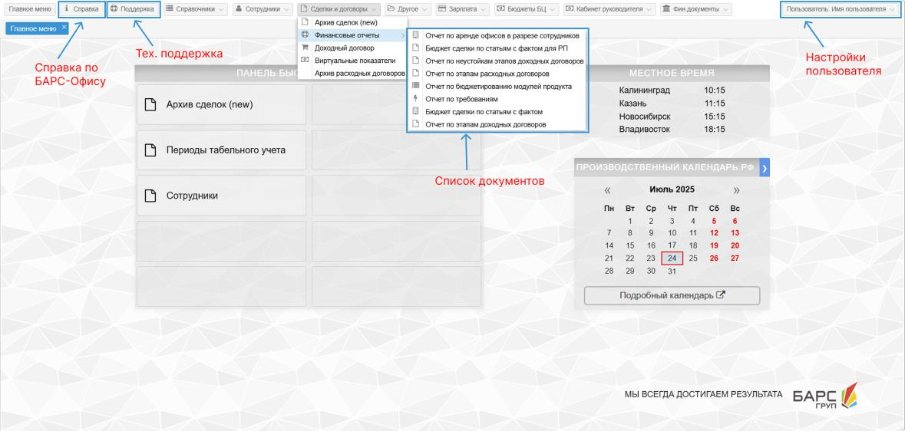

### 1.1 Главное меню

Главное меню БО представляет собой набор разделов в левой части верхней панели (набор пунктов меню меняется в зависимости от роли пользователя), при нажатии на которые открывается список их содержимого, доступного пользователю.

В нижней части интерфейса главного меню находятся:

#### 1.1.1 Панель быстрого доступа

Данный инструмент позволяет закреплять документы в специальной зоне для мгновенного доступа, работая как персонализированная панель избранного.

Доступные функции для документов: переименование, применение сохраненных настроек и фильтров.

- Для добавления документа в избранное нужно выбрать документ в верхней панели (1) и перетащить его в выделенную область панели быстрого доступа (2) — документ закрепится в избранном.
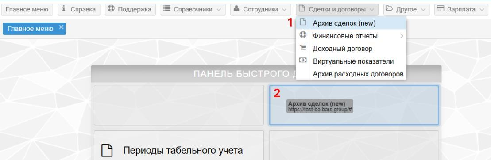

- Если у документа имеются сохраненные настройки и фильтры, то появится окно "Настройки документа". Здесь можно выбрать нужные параметры. При нажатии "Отмена" в окне выбора настроек – документ закрепится с последними использованными настройками без активного фильтра.

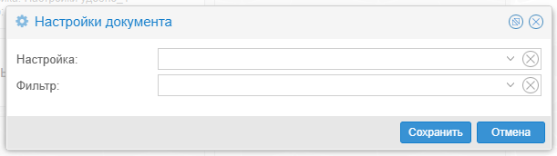

- Для редактирования наименования, настройки, фильтра необходимо кликнуть правой кнопкой мыши на документ.
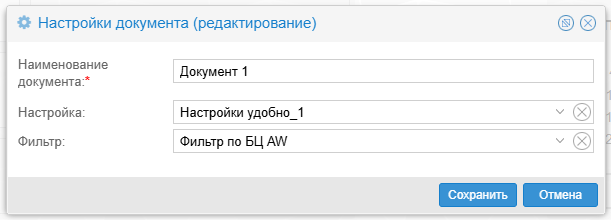

- Для удаления нужно навестись на документ и нажать на появившийся значок "Х".

Видеоинструкция по добавлению документа в быстрый доступ:

#### 1.1.2 Местное время

Отображает текущее время для городов: Калининград, Казань, Новосибирск, Владивосток.

#### 1.1.3 Производственный календарь

Производственный календарь с возможностью переключения между Российской Федерацией (РФ) и Республикой Татарстан (РТ).

При нажатии на кнопку "Подробный календарь" откроется полный календарь рабочего времени в отдельном окне.

### 1.2 Профиль пользователя

В правой части верхней панели располагается кнопка "Пользователь: <Имя пользователя в системе>", при нажатии на которую открывается меню работы с профилем пользователя.

Основные разделы профиля пользователя:

#### 1.2.1 Сменить тему

В данном разделе можно сменить тему интерфейса БО. Для выбора доступны 6 различных тем. По умолчанию установлена "Крисп".

Выбранная тема будет применена на всех компьютерах, с которых будет произведен вами вход.

#### 1.2.2 Привязка к telegram

Данный пункт меню предназначен для подключения двухфакторной аутентификации. Для доступа к функционалу БО из внешней среды пользователь должен быть привязан к telegram. Подробнее: Инструкция по привязке к telegram

#### 1.2.3 Настройки

При выборе данного пункта откроется вкладка «Настройки» в которой есть чек-бокс «Предотвращать закрытие вкладки браузера»:

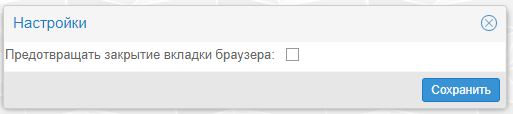

Если поставить галочку в поле чекбокса, то при попытке закрыть вкладку браузера с барс офисом будет всплывать сообщение:

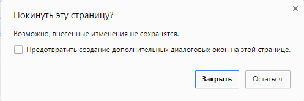

> Всплывающее сообщение не отображается при следующих действиях:

- При авторизации под другими пользователями с ролью Оборотень
- При выходе из БО с помощью меню пользователя(кнопка выход)
- При печати с помощью действия "Реестр контактов" в документе "Отчет по этапам доходных договоров"

#### 1.2.4 Выход

Выход из системы. Также выход системы осуществляется автоматически, если не работать в БАРС-Офисе больше 2 часов.

## 2 Работа с документами БО

### 2.1 Инструменты поиска данных

#### 2.1.1 Редактор фильтров

Выражение для фильтрации можно отредактировать перейдя в редактор фильтров либо сбросить.

Открыть редактор фильтров можно посредством нажатия на изображение лупы в строке фильтра (на нижней панели БО) В редакторе можно задать более сложные диапазоны условий сгруппированные по категориям “и”, “или”, “не и”, “не или” и применить к текущему документу.

Как работать с категориями (правила работы соответствуют свойствам Булевой алгебры), пример:

В приведенном на картинке ниже примере настроенный фильтр соответствует следующему его текстовому описанию: ([Наименование] содержит "а" и [Дата создания] > "01.07.2018") или ([БЦ] в списке "[МЕДМИС,ОБР]") не и ([Период] < "2017-01" и [Дата редактирования] < "01.01.2018"), т.е.:

- фильтр выдаст записи, которые соответствуют фильтру по первой группе, прибавит к этому набору записи, которые соответствуют фильтру по второй группе (т.к. вторая группа имеет категорию "или") и уберет из полученного набора (по первой и второй группе) записи, соответствующие третьей группе (т.к. выбрана категория "не и")
- внутри группы все условия фильтрации применяются согласно выбранному фильтру
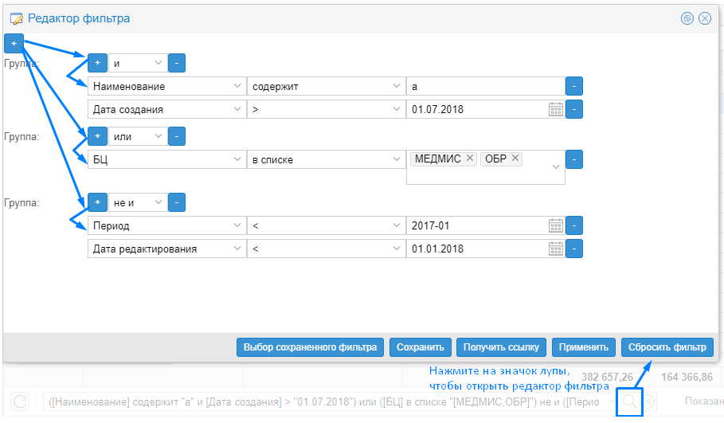

Для перечисления нескольких значений необходимо выбрать условие отбора "В списке" и прописать все варианты через запятую (без лишних пробелов и без кавычек) или выбрать значения из выпадающего списка Чтобы применить настроенный фильтр, необходимо нажать на кнопку "Применить" в редакторе фильтра. Настроенный фильтр можно сохранить (предварительно указав его название):

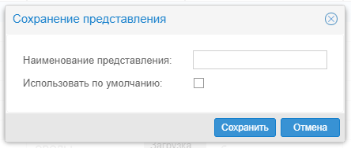

и впоследствии выбирать его для фильтрации данных (посредством нажатия на кнопку "Выбор сохраненного фильтра" в редакторе фильтра) или использовать его по умолчанию (при проставлении галочки в поле "Использовать по умолчанию" при сохранении такого фильтра - фильтр будет использоваться всегда, при открытии документа).:

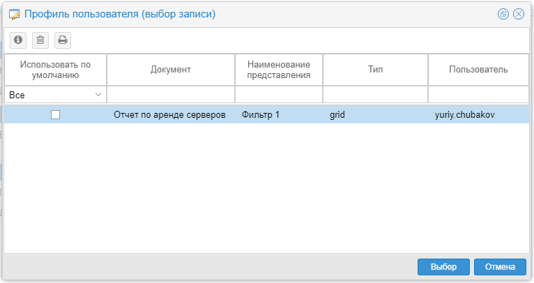

При этом, если у фильтра поле Пользователь пустое, то он применяется для всех.

Имеется также возможность "Получить ссылку" на фильтр документа. Подробнее по ссылке

#### 2.1.2 Фильтрация по столбцам

По столбцам с числовыми значениями (суммы, статусы в воронке) можно настраивать фильтрацию с помощью символов " >","<" ,"=", "!=" (не равно)

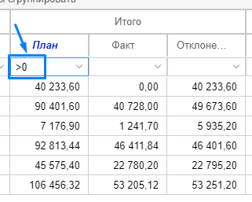

Также фильтрация с помощью символов " >","<" ,"=", "!=" (не равно) может применяться в отношении дат:

> В поле фильтра необходимо указывать дату в формате "dd.mm.yyyy"

Символы "!=" (не равно) и "=" (равно) также можно применять и к текстовым значениям:

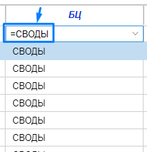

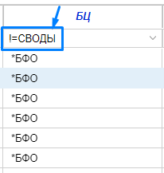

Имеется возможность фильтрации по любому содержимому столбца: при нажатии на стрелочку, располагающуюся справа под названием столбца, открывается выпадающий список значений этого столбца (присутствует возможность множественного выбора)

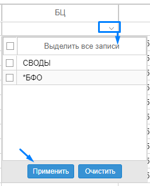

Также доступна возможность ручного задания фильтра по столбцу, следующим способом: в поле под названием столбца можно написать следующий текст - in <>|<>|<>|...|<> , где

- <> - Содержимое столбца, по которому происходит фильтрация (например, наименование БЦ)
- `|` — символ перечисления содержимого, по которому происходит фильтрация (значение «или»)

> После "in" обязательно должен следовать пробел.
> Между содержимым фильтруемого столбца и символом "|" не должно быть пробелов.
>
> Пример фильтра по столбцу "Бизнес центр": `in ИТ_ТЕХ|HRПП|UX|ИТ_ОРТД|СОКПО|ИТ_ОСА|КЦ|HRBP` — данный фильтр позволяет отобрать все записи отчета, где Бизнес центр является распределяемой службой.
>
> Чтобы отобрать все записи, которые содержат «пустое значение» в фильтруемом столбце, нужно написать `in ` (in + пробел) или в некоторых случаях: `in _-_`.

### 2.2 Инструменты работы с записями

#### 2.2.1 Группировка записей

Некоторые документы поддерживают группировку по столбцам. Для этого необходимо перетащить название столбца в поле с надписью "Перетащите колонку сюда чтобы сгруппировать":

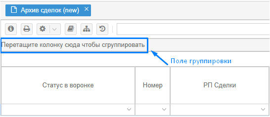

- Чтобы убрать все группировки необходимо нажать "Очистить группу" через контекстное меню в поле группировки (вызывается правой кнопкой мыши).
- Чтобы раскрыть все сгруппированный строки нужно нажать "Раскрыть все " через контекстное меню в поле группировки.
- Чтобы свернуть все сгруппированный строки нужно нажать "Свернуть все " через контекстное меню в поле группировки.
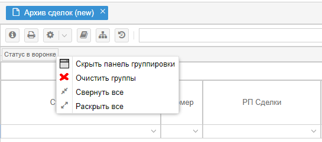

1. При закрытии документа пользовательские группировки документа сохраняются
2. При группировке по определенному столбцу так же можно по нему провести сортировку (по возрастанию/ убыванию)

#### 2.2.2 Изменение записей

Каждый документ содержит стандартные элементы управления:

- Справка
- Добавление
- Редактирование
- Копирование
- Удаление

Те же самые элементы управления доступны при нажатии правой кнопки мыши в появившемся контекстном меню:

Figure 1 context_menu

Дополнительно, возможно для добавления использовать клавишу “Insert”, а для удаления клавишу “Delete”

#### 2.2.3 Итоговая информация

Для дополнительной аналитики,в правом нижнем углу документов, имеется итоговая строка, показывающая итоговое значение по загруженным данным.

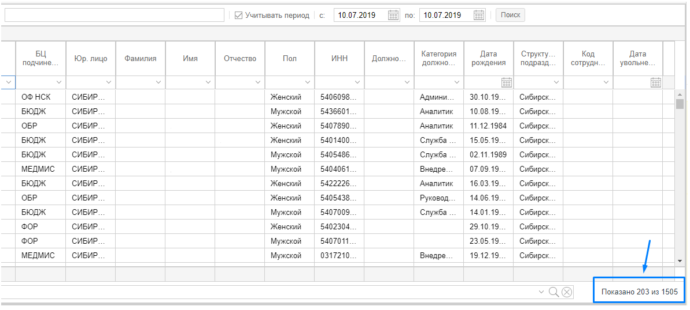

При группировке по столбцам показывается дополнительная подытоговая строка Итоговая информация представляет собой итоговые суммы (по столбцам, которые формируются из поля типа "Число").

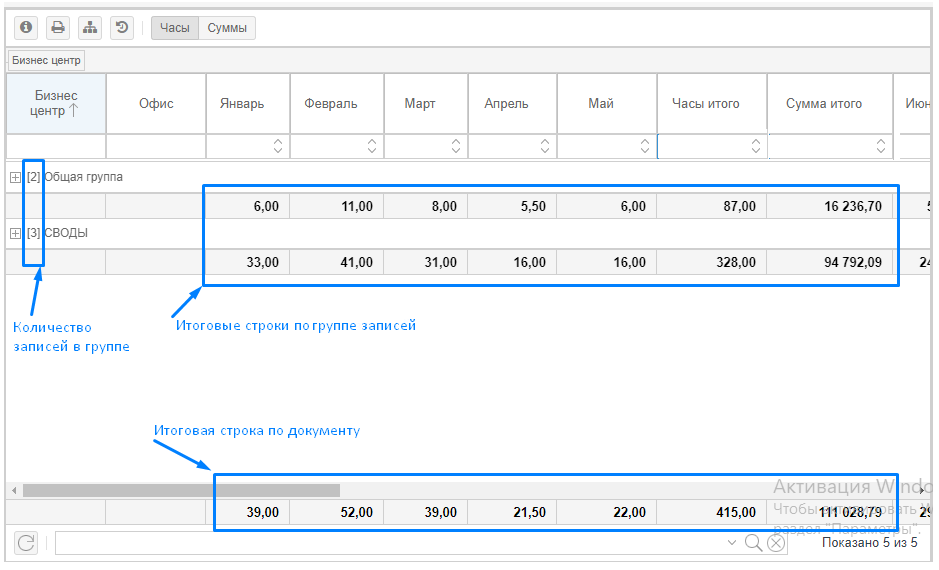

### 2.3 Возможности отображения и инструменты настройки

#### 2.3.1 Компоновка расположения зависимых документов

Для управления расположением таблиц на экране нажмите кнопку “Компоновка расположения таблиц”:

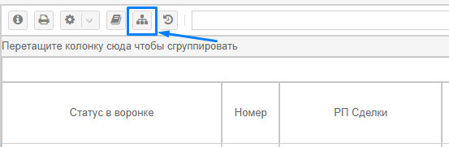

Чтобы сбросить настройки по умолчанию нажмите на кнопку "Сбросить настройки по умолчанию".

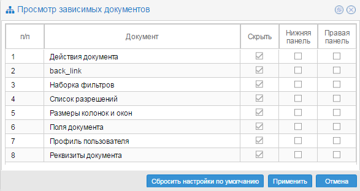

> **Настройки расположения.** В форме «Просмотр зависимых документов» не отображаются текущие настройки расположения.
>
> После закрытия документа текущие пользовательские настройки сохраняются.

Доступны варианты формирования компоновки таблиц “направо-вниз” и “вниз-направо”

или

> Можно так же изменять ширину функциональных панелей. Она сохраняется при закрытии документа.

При открытии в отдельной вкладке на таблицу накладываются конкретные фильтры в зависимости от текущего расположения таблицы Фильтр в данном случае можно снять или расширить для анализа данных уже без контекста родительской таблицы.

#### 2.3.2 Открыть в окне

Для некоторых зависимых документов имеется возможность открыть документ в виде всплывающего окна. Для этого необходимо выбрать соответствующий документ в пункте меню "Открыть в окне":

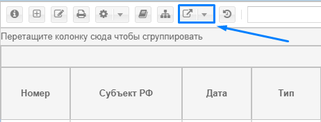

#### 2.3.3 Пользовательские настройки отображения таблиц

Существует возможность настроить отображение таблицы: скрыть столбцы, изменить их ширину и порядок.

Скрытие/отображение столбцов настраивается во всплывающем меню "Столбцы", путем деактивации или активации чек-бокса. При активации чек-бокса "Выделить все" активируются все другие чек-боксы, следовательно все поля отображаются в документе.

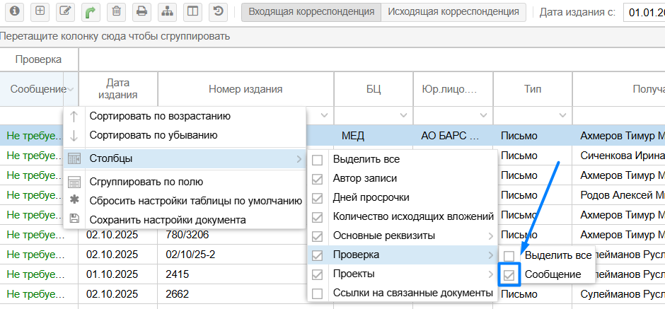

Изменение ширины столбца осуществляется стандартным действием - потянуть за правую границу наименования столбца влево или вправо.

Так же существует настройка, с помощью которой можно равномерно распределить столбцы по ширине экрана( чтобы они не вылезали за его предела). Это можно сделать с помощью активации чек-бокса "Столбцы по ширине экрана"

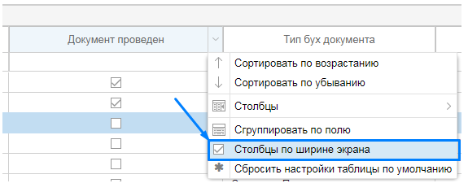

- данная настройка работает в документах, у которых количество столбцов меньше 17-ти.

Изменить порядок расположения столбца можно путем перетаскивания наименования столбца. Пользовательские настройки сохраняются при закрытии документа или странички браузера. Чтобы сбросить пользовательские настройки необходимо выбрать во всплывающем меню пункт "Сбросить настройки таблицы по умолчанию":

#### 2.3.4 Всплывающая информация (подсказки)

При наведении курсора на поле (наименование) столбца, отображается подробная информация по названию/ аналитике столбца(если информация имеется):

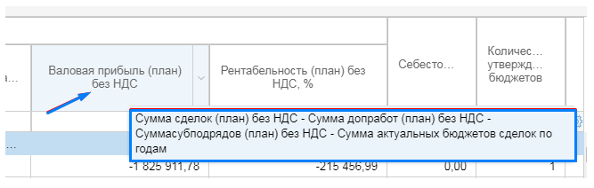

Также всплывающие подсказки используется в расчетных показателях в таких отчетах как: Отчет по рентабельности сделок, P&L, вкладка "Паспорт сделки" в бюджете сделок.

#### 2.3.5 Раскрывающаяся панель (Expand panel)

!Используется не во всех отчетах Для того, чтобы развернуть такую панель необходимо нажать на знак

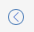

стрелки (пример использования: Реестр серверов, вкладка "Паспорт сделки" в бюджете сделок, Отчет по этапам доходных договоров и др.) Скрыть такую панель можно двумя способами: двойным кликом левой кнопки мыши по границе панели или нажатием на правую стрелочку в наименовании панели (если есть).

Ниже пример (видео файл):

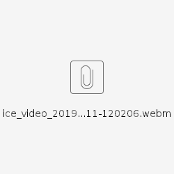

#### 2.3.6 Сохранение нескольких представлений отчетов

Для того, чтобы сохранить заданный порядок полей, их размер, отображение, необходимо:

1. после проведения необходимых настроек нажать кнопку "Сохранить настройки документа"
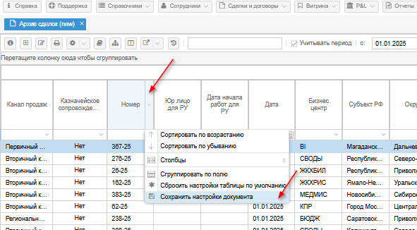

2. задать название настройки и сохранить ее
3. просмотреть список сохраненных настроек можно через функционал Настройки документа
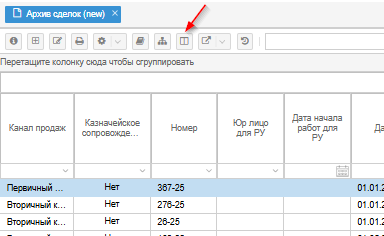

4. активировать настройку можно ПКМ, по кнопке Активировать
5. после активации появится сообщение о том, что настройка будет применена при следующем открытии документа.

Чтобы сохранить открытым связанный документ (например, Бюджеты сделок в Архиве сделок), нужно:
1. открыть связанный документ и применить настройку
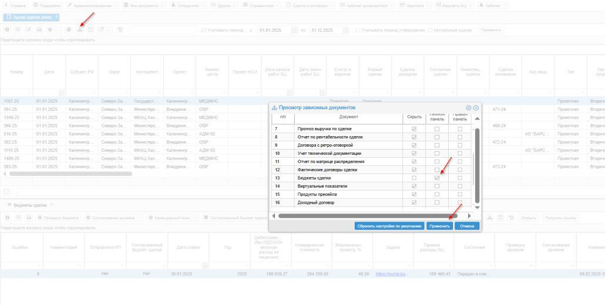

2. при последующих загрузках документа Архив сделок, связанный документ Бюджеты сделки будет открываться сразу

### 2.4 Дополнительные возможности

#### 2.4.1 Справка

Для получения справки (подробного описания) по необходимому документу, необходимо открыть соответствующий документ и на верхней панели инструментов нажать кнопку "i":

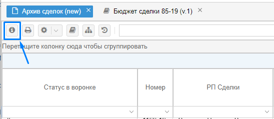

После нажатия на эту кнопку, в БО откроется вкладка с названием "Справка" (страница в conflunce):

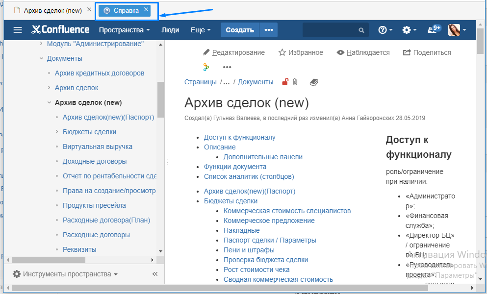

#### 2.4.2 Поддержка

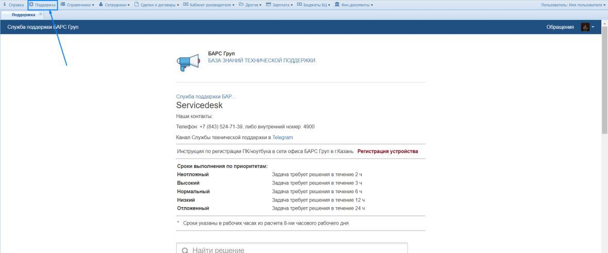

Для решения вопросов по БарсОфису, можно нажать на кнопку "Поддержка", при нажатии на которую откроется окно с СТП.

#### 2.4.3 Вывод данных в Excel

Для вывода данных в Excel нажмите кнопку “Печать” расположенную на верхней панели управления:

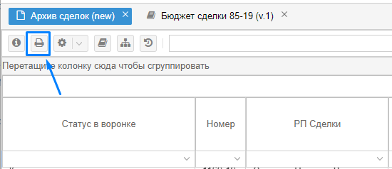

Названия Exel-файлов аналогично названию открытых во вкладке документов.

Обращаем внимание на то, что отобразятся в печатной форме только те данные, которые отобраны на текущем экране с учетом наложенных фильтров и величины размера станицы.

- Добавлена (суммирующая) итоговая строка в выгружаемый xls файл, которая рассчитывается динамически (при изменении/добавлении значений строк) - только для документов, у которых присутствует строка итогов
- Добавлены фильтры по столбцам

#### 2.4.4 Просмотр истории объектов

Добавлена кнопка отображения истории (для документов, основанных на БД БО, за исключением представлений), при нажатии на которую открывается форма со следующей информацией:

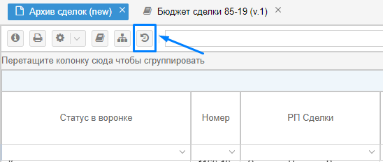

- пользователь автор
- пользователь последнего редактирования
- дата создания
- дата редактирования
- таблица просмотра детализации по сделанным изменениям
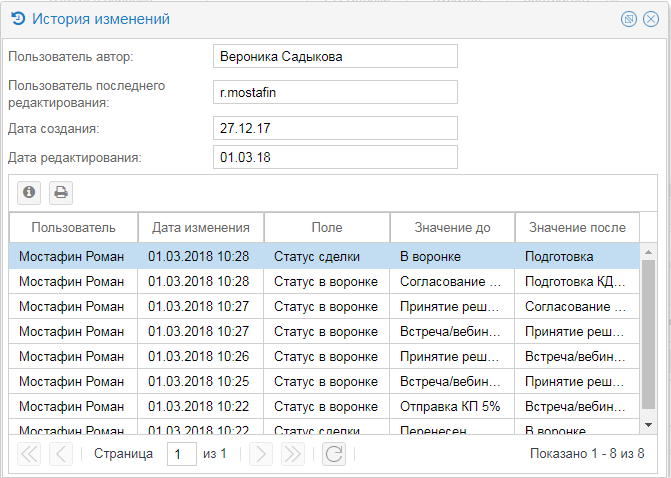

Для роли "Настройка" доступно редактирование истории.

#### 2.4.5 Ссылки на документ

В каждом документе имеется возможность получить ссылку (URL) на документ с настроенным фильтром.

Для получения ссылки нужно открыть "Редактор фильтра" и нажать кнопку "Получить ссылку".

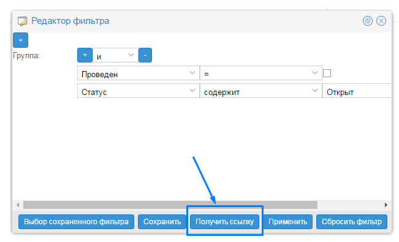

Откроется окно с ссылкой:

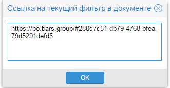

#### 2.4.6 Оповещение при ошибках UI

При возникновении ошибок верстки в web БО, выводится сообщение о необходимости перезагрузить страницу: "Возникла исключительная ситуация, требуется обновить страницу.".

Figure 2 screenshot-1.png

При нажатии на кнопку "Перезагрузить" появляется окно подтверждения перезагрузки страницы.

Актуально при ошибках Ext.Error.

#### 2.4.7 Работа в мобильной версии браузера

Для удобной работы в WEB БО на основной панели имеется скролл бар. Пример работы: *(видео из исходного PDF не извлечено — в экспорте осталась заглушка «Your browser does not support the HTML5 video element»).*
