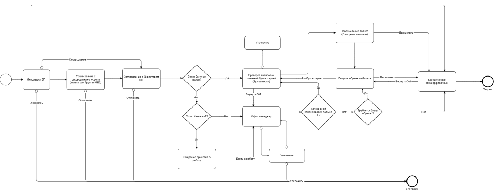

# БП Командировка

## Содержание

- [1 Содержание](#1-содержание)
- [2 Схема бизнес-процесса](#2-схема-бизнес-процесса)
- [3 Для кого](#3-для-кого)
- [4 Для чего](#4-для-чего)
- [5 Инструкция](#5-инструкция)
- [6 Дополнительная информация](#6-дополнительная-информация)
  - [6.1 Замена билетов, изменение времени вылета](#61-замена-билетов-изменение-времени-вылета)
  - [6.2 Как отслеживать БП?](#62-как-отслеживать-бп)
  - [6.3 Дополнительный функционал для руководителей отделов и директоров БЦ](#63-дополнительный-функционал-для-руководителей-отделов-и-директоров-бц)

## 1 Содержание

> Для оперативной работы по заказу авиа и ж/д билетов введено дежурство офис-менеджеров:
>
> - Понедельник – Пятница с 17:30 до 21:00,
> - Суббота – Воскресенье с 10:30 до 21:00.
>
> Дежурный офис-менеджер доступен по телефону +79991002030.
>
> В Новосибирске обращаться в рабочее время к Иванову Ивану.

## 2 Схема бизнес-процесса

## 3 Для кого

- Для сотрудников компании, отправляемых в командировки

## 4 Для чего

- заказ билетов
- получение подотчётных сумм (в том числе аванс командировочных)
- формирование отчета о командировке

## 5 Инструкция

1. Авторизоваться в `bp.bars.group`.
2. Нажать кнопку «Создать запрос».
3. Выбрать проект «Процессы БАРС Груп (BP)» и тип запроса «Командировка».
4. Заполнить форму (необходимо заполнять поля последовательно, сверху вниз):

    - **Подразделение** — подразделение, за чей фонд покупаются билеты. Для выбора доступны все подразделения.
    - **Офис** — офис-менеджер какого офиса будет покупать билеты (если затрудняетесь, то следует выбирать Казанский).
    - **Сотрудник** — сотрудник, которому заказываются билеты. Можно заказать билеты как себе, так и другому сотруднику компании.
    - **Номер пресейла** — сделка, на которую сядут расходы по заказу билетов. Обязательно для Бизнес-центров и Производственных служб.

      Начните вводить номер сделки и выберете из выпадающего списка нужную. Можно выбрать несколько сделок.

      *По какому принципу фильтруются сделки?*

        - если выбрано подразделение с категорией «Бизнес-центр», то данное поле обязательное для заполнения и в списке отображаются следующие сделки:

            - процент статуса в воронке >= 60%;
            - указана дата начала работ;
            - есть бюджет на текущий год;
            - в бюджете запланированы суммы по билетам и/или командировочным;
            - фильтр по году сделки: сделки текущего года или следующие;
            - фильтр по БЦ:
                - БЦ сделки из поля «Подразделение»;
                - директору подразделения доступны сделки всех подразделений, по которым он является должностным лицом;
            - исключены сделки в статусах «Завершен», «Отказ» и продуктовые сделки.

        - если выбрано подразделение с категорией не «Бизнес-центр», то есть службы, то данное поле не обязательное для заполнения и отображаются сделки текущего года с бюджетом на текущий год (исключены сделки в статусах «Завершен» и «Отказ»).

    - **Процент разнесения** — через пробел указать процент разнесения для указанных сделок, в соответствующем порядке. Дробные числа указываются через точку:

        - если выбрана одна сделка, то всегда указывается 100;
        - если выбрано несколько сделок, то необходимо указать, в каком процентном соотношении будут разнесены расходы.

    - **Заказ билетов** — выбрать, требуется ли заказ билетов:

        - туда и обратно;
        - только туда;
        - не требуется.

        > Если покупка билетов не требуется, нужно обязательно заполнить поле «Командировочные», иначе бизнес-процесс не получится отправить на согласование.

    - **Комментарий** — комментарий к заказываемым билетам (например, номер и время рейса).
    - **Дата с** — дата начала командировки, дата, на которую необходимо купить билет в место назначения.
    - **Дата по** — дата окончания командировки, дата, на которую необходимо купить обратный билет (укажите предполагаемую дату, если неизвестна фактическая).

        > Если дата покупки обратного билета неизвестна, то укажите это в комментариях к заказываемым билетам (или в комментариях заявки). Офис-менеджер свяжется с вами для уточнения информации.

    - **Место отправления** — указать место отправления (откуда вылет).
    - **Место назначения** — указать место назначения (куда прилет).
    - **Время вылета туда** — указать, в какое время отправляется рейс (часы и минуты).
    - **Время вылета обратно** — указать, в какое время отправляется рейс (часы и минуты).
    - **Организация в месте назначения** — например, Офис БАРС Груп.
    - **Аренда жилья** — сумма стоимости аренды жилья. Если сотрудник планирует самостоятельно снимать и оплачивать — нужно внести в это поле необходимую сумму, она будет выплачена в качестве командировочных; иначе (если самостоятельно оплачивать не планирует) нужно оставить поле пустым, офис-менеджер самостоятельно забронирует жилье в случае необходимости.
    - **Командировочные и другие расходы** — указать сумму, если необходимо получение подотчётных сумм (в том числе командировочных).
    - **Цель выплаты командировочных** — расшифровать назначение подотчётных сумм.

        > Для выплаты подотчетных сумм (командировочных) поля «Командировочные» и «Цель командировочных» обязательны для заполнения.

    - **Цель командировки** — указать цель командировки.
    - **Сумма аванса** — сумма рассчитывается автоматически, на основании кол-ва дней командировки. Формула расчета: (Дата по − Дата с) × 700.
    - **Согласие на обработку/передачу персональных данных** — для запуска БП необходимо отметить данный чек-бокс. При создании в БП автоматически загружаются файлы согласия на обработку и передачу персональных данных.
    - **Шаблоны файлов**
        - Согласие на обработку персональных файлов

          

        - Согласие на передачу персональных данных

          

5. После заполнения данных необходимо нажать «Создать». Создается бизнес-процесс в статусе «Новый».
6. После создания необходимо проверить правильность внесённых данных. Можно выполнить действие «Редактировать» для редактирования введенных данных или «Отклонить», в случае если бизнес-процесс является неактуальным.
7. Если всё заполнено правильно, то нажать «На согласование» для запуска бизнес-процесса. Процесс назначается на руководителя выбранного подразделения для согласования.

    > **Важно.** Автоматически проверяется доступность средств в бюджете подразделения или бюджете сделки. Если в бюджете остаток по билетам меньше 1000 руб. или остаток по командировочным меньше запрашиваемой суммы командировочных, то процесс останавливается и возвращается автору для корректировки бюджета сделки в БАРС-Офисе. Автор должен обеспечить корректировку бюджета и вернуть процесс на согласование.
    >
    > Проверить доступность средств по бюджету можно в самом бизнес-процессе заказа билетов, в поле «Служебная информация»: отклонение должно быть не меньше текущей суммы.
    >
    > **Примечание:** значение в поле «Тек. сумма» по статье «билеты» появляется после внесения суммы офис-менеджером (в статусе «Офис-менеджер»).
    >
    > В поле «Служебная информация» отображается план и факт по статьям «Билеты» и «Командировочные» за текущий год.
    >
    > - если в поле «Подразделение» выбран бизнес-центр, то отображается информация по бюджету сделки:

    Пример поля «Служебная информация» (бюджет сделки). Таблица в исходном PDF сверстана без чёткой сетки, ниже — восстановленная разметка по видимым числам:

    | Сделка | БЦ сделки | Статьи расходов | Сумма план | Сумма факт | Резерв | Отклонение | Тек. сумма |
    | --- | --- | --- | ---: | ---: | ---: | ---: | ---: |
    | номер_сделки | БЦ_сделки | Аренда жилых помещений | 5 000 | 1 000 | 0 | 4 000 | 1 000 |
    | номер_сделки | БЦ_сделки | Билеты | 10 000 | 2 000 | 1 000 | 7 000 | 1 000 |
    | номер_сделки | БЦ_сделки | Командировочные | 30 000 | 8 000 | 0 | 22 000 | 1 000 |
    | Итого |  |  | 45 000 | 11 000 | 1 000 | 33 000 | 3 000 |

    - если в поле «Подразделение» выбрана служба, то отображается информация по бюджету подразделения:

    Пример поля «Служебная информация» (бюджет подразделения):

    | Код БЦ | Статьи расходов | Сумма план | Сумма факт | Резерв | Отклонение | Тек. сумма |
    | --- | --- | ---: | ---: | ---: | ---: | ---: |
    | БЦ | Билеты | 10 000 | 2 000 | 1 000 | 7 000 | 1 000 |
    | БЦ | Командировочные | 30 000 | 8 000 | 0 | 22 000 | 1 000 |
    | Итого |  | 40 000 | 10 000 | 1 000 | 29 000 | 2 000 |

8. После согласования, если требуется заказ билетов, процесс переходит в работу на офис-менеджеров.

    > **Важно.** Офис-менеджеры проверяют доступность средств в бюджете подразделения или бюджете сделки на покупку билета. Если средств недостаточно, то процесс останавливается и возвращается автору для корректировки бюджета сделки в БАРС-Офисе! Автор должен обеспечить корректировку бюджета сделки и вернуть процесс обратно офис-менеджеру.
    >
    > Если билет обратно не был приобретен сразу (например, неизвестна дата возвращения), процесс возвращается на офис-менеджера после выплаты подотчетных сумм. Процесс остаётся в данном статусе до приобретения обратного билета.

9. Если требуется начисление подотчетных сумм, то процесс отправляется в бухгалтерию, где:

    a. проверяются долги по выданным подотчетным суммам;
    b. проверяются цели командировочных и наличие доступных средств в бюджете сделки;
    c. производится перечисление согласованных подотчетных сумм на карт-счет сотрудника.

    > **Важно.** Если при инициации заявки в поле «Командировочные» было указано 0, подотчетные суммы выплачены не будут.
    >
    > Перечисление подотчетных сумм бухгалтерией проводится ежедневно по будням в 16:00.
    >
    > Заявки, поступившие после 14 часов текущего дня, в платеж текущего дня включены не будут.

10. После покупки билета и перечисления подотчетных сумм автоматически создается отчет о командировке, и бизнес-процесс назначается на командируемого сотрудника.

11. По прибытию из командировки:

    > По прибытию из командировки в течение 3 календарных дней с момента возвращения необходимо обязательно предоставить нижеперечисленные документы в бухгалтерскую службу компании.
    >
    > Если вы находитесь не в Казани и не в Новосибирске, то предварительно отправьте сканы нижеперечисленных документов через мессенджер Telegram в бухгалтерскую службу для проверки (контакты ниже), а после подтверждения корректности заполнения документов отправьте оригиналы документов по почте либо передайте через коллег.

    1. Приказ на командировку:
        a. скачайте из бизнес-процесса автоматически сформированный Excel-файл;
        b. на листе «Расходы» заполните перечень расходов;
        c. распечатайте все страницы;
        d. на листе «Приказ» от руки (не печатать) заполните краткий отчет по результатам командировки, поставьте личную подпись и дату подписи (дата подписи должна совпадать с датой приказа);
        e. на листе «Расходы» поставьте личную подпись.
    2. Подтверждающие расходы документы:
        a. счет на проживание, в котором в поле наименования услуг обязательно должно быть прописано «проживание»;
        b. кассовый чек, слип-чек гостиницы;
        c. если поездка на поезде:
            i. электронные билеты;
        d. если перелет на самолете:
            i. электронные билеты;
            ii. посадочные талоны на перелет с отметками пограничных служб о досмотре;
            iii. билет на аэроэкспресс.
    3. Если вы воспользовались услугами такси, необходимо приложить:
        a. квитанцию от водителя с номером и печатью (если печати нет, то все реквизиты перевозчика должны быть напечатаны, а не вписаны от руки: название, адрес, ИНН). Все графы квитанции должны быть заполнены;
        b. если оплата непосредственно водителю — квитанцию, чек ККТ (онлайн-касса) от водителя, выписку из банка, заверенную сотрудником банка;
        c. отчет о поездке с деталями поездки (если заказ через приложение);
        d. служебную записку, заверенную и согласованную непосредственным руководителем, с указанием уважительной причины.
    4. При наличии штрафов за смену билетов или наличии невозвратных билетов необходимо написать соответствующую служебную записку, подписанную руководителем своего подразделения.

    Бланки и образцы документов находятся в разделе «Выездные документы для командировок».

    Контактные лица бухгалтерской службы, кому сдавать документы:

    - Сергей Сергеевич — по всем сотрудникам, кроме оформленных в ООО «Бюджетный учет» и «СИБИРСКИЙ ФИЛИАЛ АО „БАРС Груп“»;
    - Мария Руслановна — по сотрудникам, оформленным в ООО «Бюджетный учет» и «СИБИРСКИЙ ФИЛИАЛ АО „БАРС Груп“».

## 6 Дополнительная информация

### 6.1 Замена билетов, изменение времени вылета

1. В случае, если командированному сотруднику требуется по какой либо причине изменить время вылета/выезда - необходимо по телефону, либо по средствам мессенджеров запросить у закрепленного офис-менеджера замену (либо приобретение новых) билетов.
2. При наличии штрафов за смену билетов или невозвратных билетов, при сдаче авансового отчёта, сотрудник обязан предоставить в бухгалтерию служебную записку, подписанную руководителем своего подразделения.

    > Штрафы за смену билетов, стоимость невозвратных билетов могут быть удержаны из заработной платы командируемого сотрудника, если служебная записка оформлена неправильно либо причина понесенных расходов будет признана несущественной.

### 6.2 Как отслеживать БП?

Для работы с БП созданы следующие рабочие столы:

1. Отслеживание командировок требующих сдачи подотчетных документов: «Командировка»
2. Отслеживание БП требующих вашего участия: «Бизнес процессы на мне»
3. Отслеживание командировок сотрудниками бухгалтерии: «Бухгалтер.Командировка»
4. Отслеживание командировок офис-менеджером:
  - «Ожидают принятия в работу»
  - «Покупка билетов»

Для появления рабочего стола на панели быстрого доступа необходимо добавить его в «избранное».

### 6.3 Дополнительный функционал для руководителей отделов и директоров БЦ

При переходе БП в статус "Руководитель отдела" и "Директор БЦ" в бот "Бот БАРС-Офис" приходит уведомление о БП с возможностью согласовать/отклонить.
