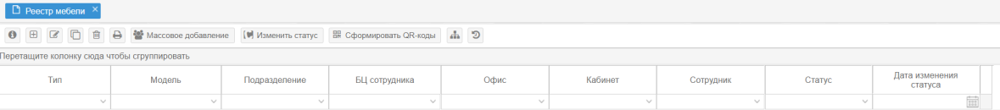
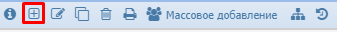
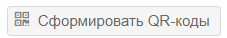
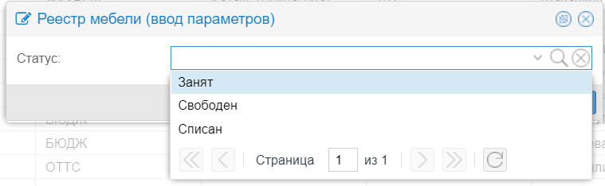

# Реестр мебели

## Содержание

- [1 Доступ к функционалу](#1-доступ-к-функционалу)
- [2 Список классификаторов/справочников](#2-список-классификаторовсправочников)
- [3 Описание](#3-описание)
  - [3.1 I. Описание документа](#31-i-описание-документа)
  - [3.2 II. Функции документа](#32-ii-функции-документа)
- [4 Список полей](#4-список-полей)
- [5 Справка](#5-справка)
- [6 Инструкция работы с функционалом](#6-инструкция-работы-с-функционалом)

**Адрес:** `bo.bars.group`

**Как открыть:** WEB BO → Документы → Реестр мебели

**Цели:**

- Контроль наличия мебели
- Контроль движения мебели
- Поиск мебели

## 1 Доступ к функционалу

- Администратор
- Офис-менеджер
- Директор БЦ (ограничение по БЦ)

## 2 Список классификаторов/справочников

- Модель мебели
- Список кабинетов
- Статус мебели
- Бизнес-центры
- Сотрудники (только чтение)

## 3 Описание

### 3.1 I. Описание документа

Документ предназначен для ведения реестра мебели (офисных принадлежностей) и их контроля

> Основной вид

### 3.2 II. Функции документа

1. Добавление записи
2. Массовое добавление
3. Массовое изменение статуса
4. Печать QR-кодов
5. Копирование
6. Редактирование
7. Удаление

## 4 Список полей

Тип – тип мебели (офисной принадлежности)

Модель – модель мебели (офисной принадлежности)

Подразделение – подразделение, за которым закреплена мебель (офисная принадлежность)

БЦ Сотрудника – подразделение, в котором оформлен сотрудник

Офис – офис, за которым закреплена мебель (офисная принадлежность)

Кабинет – кабинет, за которым закреплена мебель (офисная принадлежность)

Сотрудник – сотрудник, за которым закреплена мебель (офисная принадлежность)

Статус – текущий статус мебели (занят, свободен, списан)

Дата изменения статуса – дата последнего изменения статуса

## 5 Справка

1. Реализована периодическая задача автоматического обновления статуса по закрепленному сотруднику.

   *Описание работы:*

   - если за уволенным сотрудником закреплена мебель в статусе "Занят", то статус обновится на "Свободен";
   - если за действующим сотрудником закреплена мебель в статусе "Свободен", то статус обновится на "Занят".
2. При ручной или автоматической смене статуса, в поле "Дата смены статуса", автоматически фиксируется дата смены статуса

## 6 Инструкция работы с функционалом

### 1. Добавление записи

1. Нажать на кнопку добавить
2. Заполнить поля
  a. Модель – выбрать требуемую модель из справочника "Модель мебели". Формы выбора открывается нажатием на иконку «лупа». Внимание! Учитывайте тип мебели при выборе модели.

  b. Подразделение – выбрать требуемое подразделение из справочника "Бизнес центр"
  c. Кабинет – выбрать требуемый кабинет. Внимание! Учитывайте офис при выборе кабинета.
  d. Инвентарный номер – заполняется вручную. Значение сохраняется в верхнем регистре.
  e. Сотрудник – выбор сотрудника из справочника. Поле не обязательно к заполнению.
  f. Статус – статус мебели (офисной принадлежности). Значение по-умолчанию "Свободен"
3. Нажать на кнопку "Сохранить"

### 2. Массовое добавление записи

1. Нажать на кнопку массового добавления

2. Заполнить поля
  a. Модель – выбрать требуемую модель из справочника "Модель мебели". Формы выбора открывается нажатием на иконку «лупа». Внимание! Учитывайте тип мебели при выборе модели.

  b. Подразделение – выбрать требуемое подразделение из справочника "Бизнес центр"
  c. Кабинет – выбрать требуемый кабинет. Внимание! Учитывайте офис при выборе кабинета.
  d. Количество – указать количество создаваемых записей. Для внесения доступны значения от 1 до 100 включительно.
3. Нажать на кнопку "Сохранить".

Создастся число записей согласно указанному количеству, в статусе "Свободен". Внесение инвентарного номера, закрепление сотрудника и изменение статуса доступно на форме редактирования.

### 3. Списание мебели (офисных принадлежностей)

1. Открыть форму редактирования записи
2. Сменить статус на "Списан"
3. Нажать кнопку "Сохранить".

По списанной мебели проводится автоматическое открепление сотрудника. В поле "Дата смены статуса" фиксируется дата списания.

### 4. Печать QR-кодов

1. Нажать на запись в реестре мебели.

2. Нажать на кнопку.

Изображение загрузится в формате .png.
- Чтобы загрузить QR-коды по всем записям, необходимо сначала нажать ctrl+a, затем на "Сформировать QR-коды"
- Чтобы загрузить QR-коды по нескольким записям, необходимо удержать ctrl и кликнуть на нужные пункты, затем на "Сформировать QR-коды"

Изображения загрузятся в виде архива mebel.zip

### 5. Массовое изменение статуса

1. Зажать клавишу "ctrl"
2. Кликнуть на необходимые записи

3. Нажать на кнопку
4. Выбрать нужный статус в открывшемся окне

5. Нажать на "Ок"
